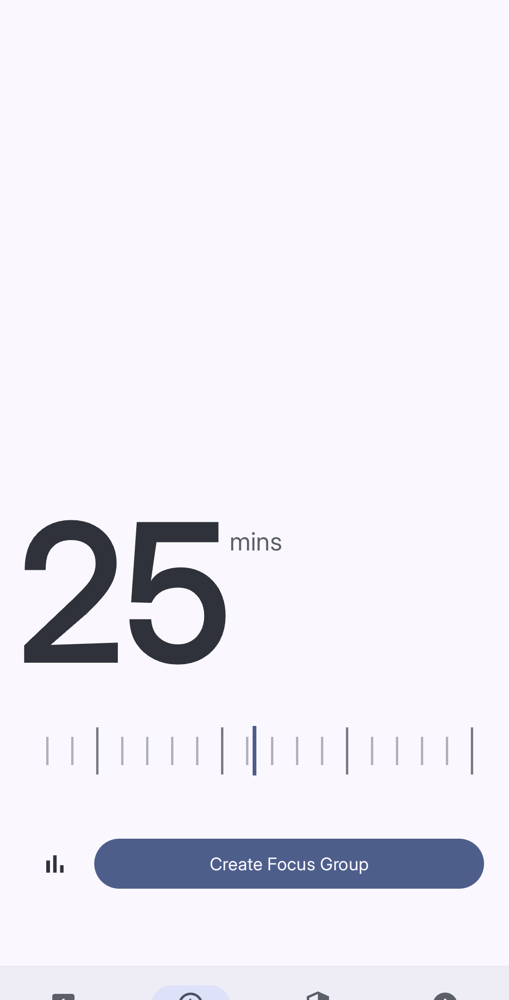
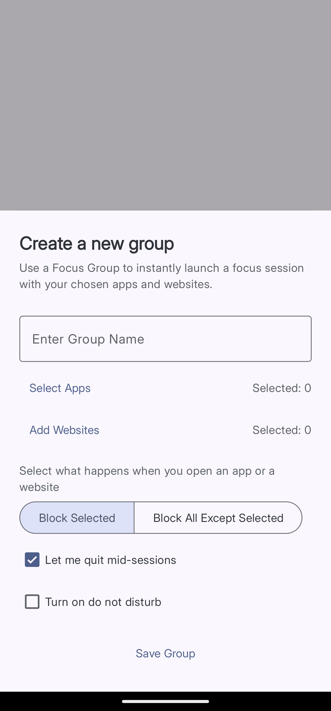
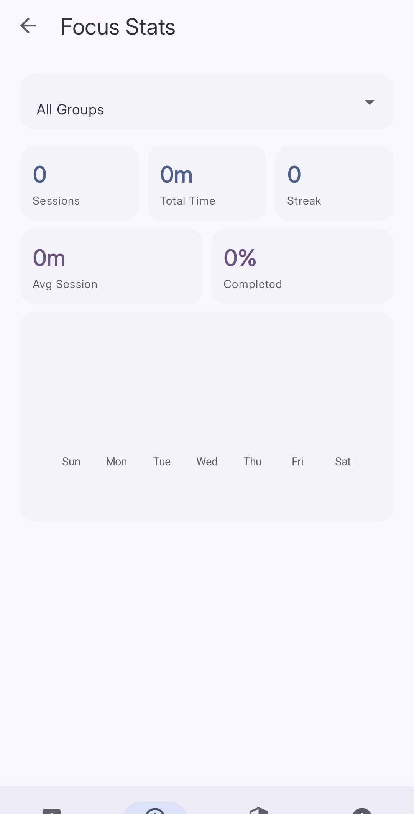

import { Steps, Aside } from '@astrojs/starlight/components';

Focus Mode blocks selected apps and websites during a timed session. When the session ends, Curbox removes the Focus Mode blocks.

## Focus Groups

A **Focus Group** is a saved set of apps, websites, and session options. You can use the same group for multiple sessions.

*Drag the slider to set the session duration.*

## Create a Focus Group

*Configure the group, and then tap Save Group.*

<Steps>
1. **Open Focus**
   Tap **Focus** in the bottom navigation bar.

2. **Create a group**
   Tap **Create Focus Group**.

3. **Enter a group name**
   Enter a short name in **Enter Group Name**.

4. **Select apps**
   Tap **Select Apps**. Select the apps that the group controls.

5. **Add websites (optional)**
   Tap **Add Websites**. Enter the websites or keywords that the group controls.

6. **Select a blocking mode**
   Select **Block Selected** to block only the selected items. Select **Block All Except Selected** to allow only the selected items.

7. **Permit an early stop (optional)**
   Turn on **Let me quit mid-sessions** to permit an early stop.

8. **Use Do Not Disturb (optional)**
   Turn on **Turn on do not disturb** to silence notifications during the session.

9. **Save the group**
   Tap **Save Group**. Curbox adds the group to the Focus screen.
</Steps>

## Start a session

<Steps>
1. **Set the session duration**
   Drag the slider on the **Focus** screen.

2. **Select a Focus Group**
   Select a saved group from the list.

3. **Start the session**
   Tap the confirmation button. Curbox applies the group until the timer ends.
</Steps>

<Aside type="tip">
If you are new to Focus Mode, start with a 25-minute session. Increase the duration after you complete several sessions.
</Aside>

## View Focus Stats

Tap the bar-chart icon next to the session slider. The **Focus Stats** screen shows these values:

- Number of sessions
- Total focus time
- Average session duration
- Completion rate
- Current daily streak

Use the group selector to show the statistics for one Focus Group.

*Use the group selector to filter the Focus Stats values.*

## Use an NFC tag

Tap the NFC icon in the upper-right corner of the **Focus** screen. Follow the on-screen instructions to connect a Focus Group to an NFC tag.

After the setup, scan the tag to start the connected session.
