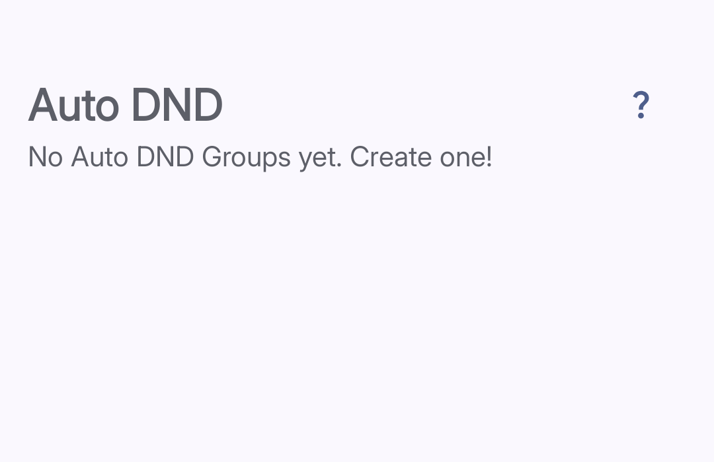

import { Steps, Aside } from '@astrojs/starlight/components';

**Auto DND** turns on Android Do Not Disturb during a configured schedule. It turns off Do Not Disturb when the schedule ends.

Auto DND requires Do Not Disturb access. Complete the permission procedure in [Set Up Curbox](../../getting-started/setup/) before you configure a group.

## Create an Auto DND group

*Tap the plus button to create a group.*

<Steps>
1. **Open Auto DND**
   Tap **Reducers**. Then, tap **Auto DND**.

2. **Create a group**
   Tap the **+** button.

3. **Enter a group name**
   Enter a name that identifies the schedule.

4. **Set the schedule**
   Tap **Time Schedule**. Select the days and times for Do Not Disturb.

5. **Save the group**
   Tap **Done**. Curbox activates the schedule.
</Steps>

<Aside type="caution">
A single Auto DND time range cannot cross midnight. Use two ranges for an overnight schedule.
</Aside>

Example: For 11:00 PM to 2:00 AM, add these ranges:

- 11:00 PM to 12:00 AM
- 12:00 AM to 2:00 AM
