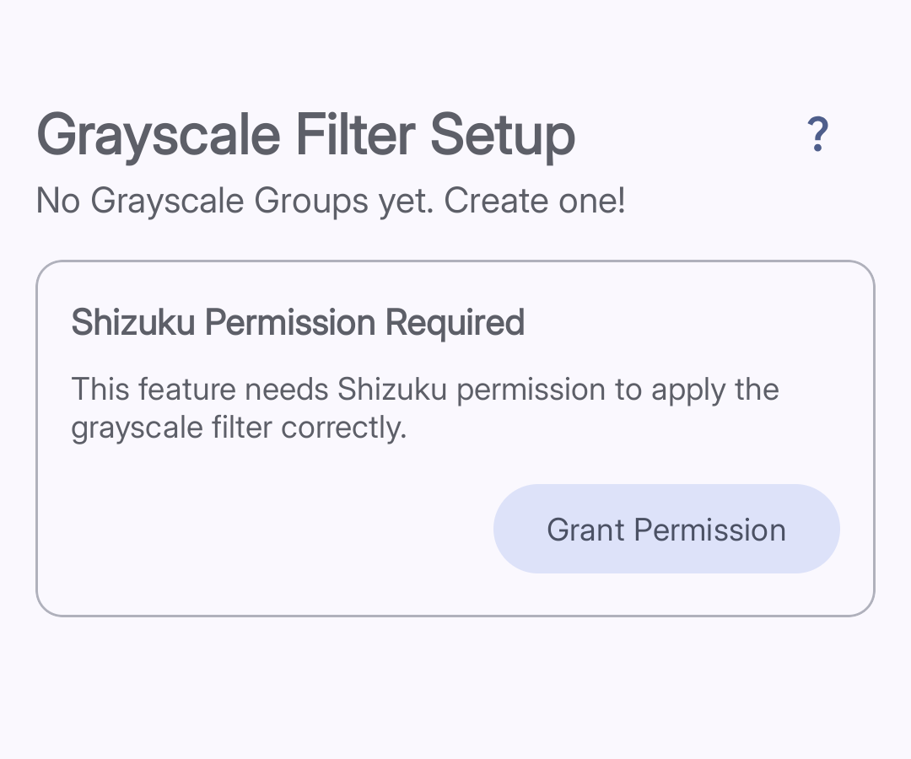

import { Steps, Aside } from '@astrojs/starlight/components';

**Grayscale Filter** removes screen colors while a selected app is open. Curbox restores the colors when you leave the app.

<Aside type="note">
Grayscale Filter requires the `android.permission.WRITE_SECURE_SETTINGS` permission. You can give this permission with Shizuku or ADB.
</Aside>

## Give the permission with Shizuku

Shizuku lets Curbox request the necessary permission without a computer. You usually complete this setup one time.


*The permission card stays visible until Curbox has the required permission.*

<Steps>
1. **Install Shizuku**
   Install Shizuku from its [official website](https://shizuku.rikka.app/).

2. **Start Shizuku**
   Open Shizuku, and complete its setup procedure. Android 11 and later can use wireless debugging.

3. **Open Grayscale Filter**
   In Curbox, tap **Reducers**. Then, tap **Grayscale Filter**.

4. **Give the permission**
   Tap **Grant Permission**. Approve the Shizuku request.
</Steps>

## Give the permission with ADB

Use this procedure if you do not use Shizuku. ADB is part of the Android SDK Platform Tools.

<Steps>
1. **Install the platform tools**
   Download [SDK Platform Tools](https://developer.android.com/tools/releases/platform-tools) to your computer.

2. **Turn on Developer options**
   Open Android **Settings**. Open **About phone**, and tap **Build number** seven times.

3. **Turn on USB debugging**
   Open **Developer options**. Turn on **USB debugging**.

4. **Connect the device**
   Connect the device to the computer with a USB cable. Approve the debugging request on the device.

5. **Check the connection**
   Run this command from the platform-tools directory:

   ```bash
   adb devices
   ```

   Make sure that the device status is `device`.

6. **Give the permission**
   Run this command:

   ```bash
   adb shell pm grant neth.iecal.curbox android.permission.WRITE_SECURE_SETTINGS
   ```

7. **Check Curbox**
   Open **Reducers**, and then open **Grayscale Filter**. The permission card must not appear.
</Steps>

## Create a Grayscale Filter group

<Steps>
1. **Create a group**
   Tap the **+** button on the **Grayscale Filter** screen.

2. **Enter a group name**
   Enter a short name.

3. **Select apps**
   Select the apps that Curbox must show in grayscale.

4. **Save the group**
   Tap **Done**. Curbox activates the filter for the selected apps.
</Steps>
