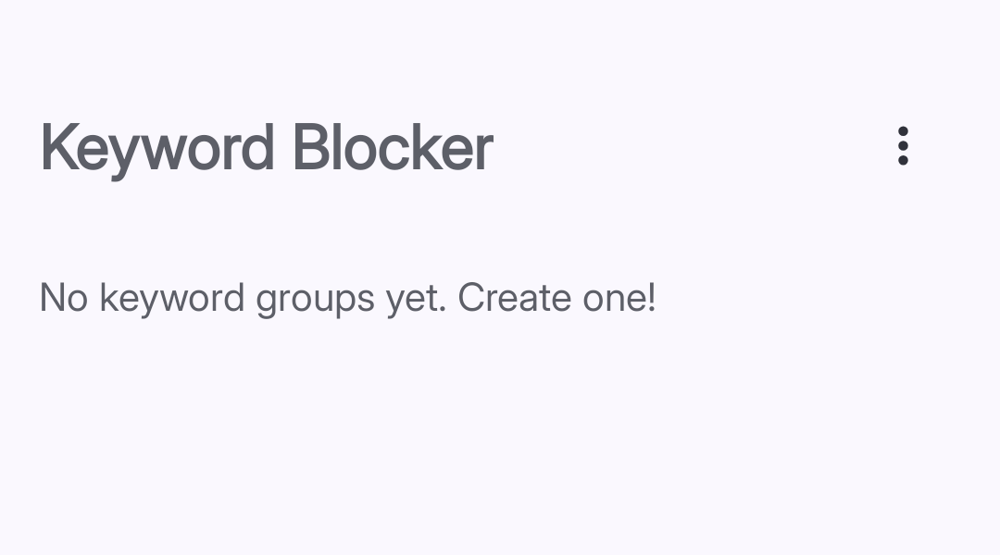

import { Steps, Aside } from '@astrojs/starlight/components';

**Keywords And Websites** reads the address in a supported browser. Curbox shows a warning screen when the address matches a configured keyword.

## Supported browsers

Curbox supports these browsers:

- Google Chrome
- Brave
- Firefox
- IronFox
- Firefox Focus
- IceRaven
- Fennec
- Vivaldi
- Opera
- Cromite
- Vanadium on GrapheneOS

<Aside type="note">
This reducer does not block a website in an unsupported browser. Use [App Pause](../app-pause/) to control an unsupported browser.
</Aside>

Developers can add a browser rule to the [Curbox project](https://github.com/nethical6/curbox/blob/main/CONTRIBUTING.md).

## Keyword group controls

| Control | Function |
|---|---|
| **Active Schedule** | Sets the days and times when the group applies |
| **Usage Limit** | Sets the permitted use duration for matching websites during the active schedule |

If **Usage Limit** is empty, Curbox blocks matching websites for the complete active schedule.

Example: A group is active from 9:00 AM to 5:00 PM. An empty limit blocks each match immediately. A 15-minute limit permits 15 minutes of use before Curbox blocks the matches.

## Create a keyword group


*Tap the plus button to create a keyword group.*

<Steps>
1. **Open Keywords And Websites**
   Tap **Reducers**. Then, tap **Keywords And Websites**.

2. **Create a group**
   Tap the **+** button.

3. **Enter a group name**
   Enter a short name that identifies the websites.

4. **Add keywords**
   Enter one domain, path, word, wildcard pattern, or regular expression in each entry. See [Keyword syntax](#keyword-syntax).

5. **Set the active schedule**
   Tap **Active Schedule**. Select the days and times when the group applies.

6. **Set a usage limit (optional)**
   Tap **Usage Limit**. Enter the permitted use duration.

7. **Configure the warning screen (optional)**
   Tap **Configure Warning Screen**. Configure the action that is necessary to continue. Read [Unlock Challenges](../../unlock-challenges/overview/) for all options.

8. **Save the group**
   Tap **Done**. Curbox activates the group.
</Steps>

<Aside type="tip">
You can import a prepared list from the [Curbox website packs repository](https://github.com/curbox-app/website_packs).
</Aside>

## Use a keyword in multiple groups

You can put the same keyword in multiple groups. This lets you use different limits at different times.

The active schedules for the shared keyword must not overlap. If they overlap, Curbox shows a warning. Change one schedule before you activate both groups.

## Keyword syntax

Select the least complex syntax that meets your requirement.

### Block a complete website

Enter the domain:

```text
youtube.com
reddit.com
twitter.com
```

Do not include `https://` or `www.`. Curbox normalizes these parts before it checks the address.

### Block one website section

Enter a domain and a path:

```text
youtube.com/shorts
instagram.com/reels
reddit.com/r/gaming
```

`youtube.com/shorts` blocks the Shorts section. It does not block other YouTube paths.

### Block a path on all websites

Start the entry with `/`:

```text
/shorts
/reels
/reel
```

For example, `/shorts` matches that path on each website.

### Use a wildcard

Use `*` to match zero or more characters:

```text
*.reddit.com
youtube.com/watch*
```

`*.reddit.com` matches Reddit subdomains. `youtube.com/watch*` matches YouTube watch addresses with different query values.

Use `?` to match one character.

### Match a word in a domain

Enter a word without a period or slash:

```text
youtube
```

This entry matches domains such as `youtube.com` and `youtube.co.uk`. It does not match the page content.

### Use a regular expression

Start a regular expression with `r:`:

```text
r:(?:shorts|reels|reel)
```

Use this syntax only when the other keyword types cannot make the required match.

<Aside type="caution">
Curbox skips a regular expression that has invalid syntax. Test the expression before you add it to a group.
</Aside>

## Import keywords from a file

Create a text file with one keyword on each line:

```text
youtube.com/shorts
instagram.com/reels
/reel
tiktok.com
```

Curbox ignores empty lines and duplicate entries.

<Steps>
1. **Open the keyword group**
   Open the group that must receive the entries.

2. **Open the group menu**
   Tap the menu in the upper-right corner.

3. **Import the file**
   Tap **Import**. Select the text file.
</Steps>

## Correct common errors

| Error | Correction |
|---|---|
| The entry contains `https://` or `www.` | Remove these parts. Enter `youtube.com`. |
| The entry is too broad, such as `com` | Add a specific domain or path. |
| The entry contains one complete video address | Remove the video identifier to match the complete section. |
| A regular expression does not match | Check its syntax and test it again. |

## Quick reference

| Requirement | Entry |
|---|---|
| Block a complete website | `youtube.com` |
| Block one section | `youtube.com/shorts` |
| Block a path on all websites | `/shorts` |
| Block all subdomains | `*.youtube.com` |
| Match a domain word | `youtube` |
| Use a regular expression | `r:(?:shorts\|reels)` |
