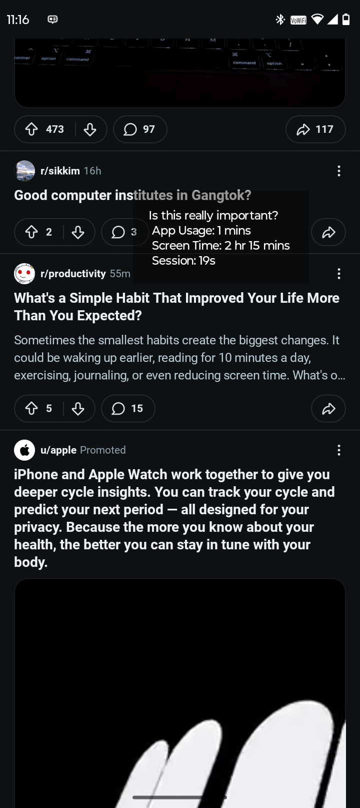
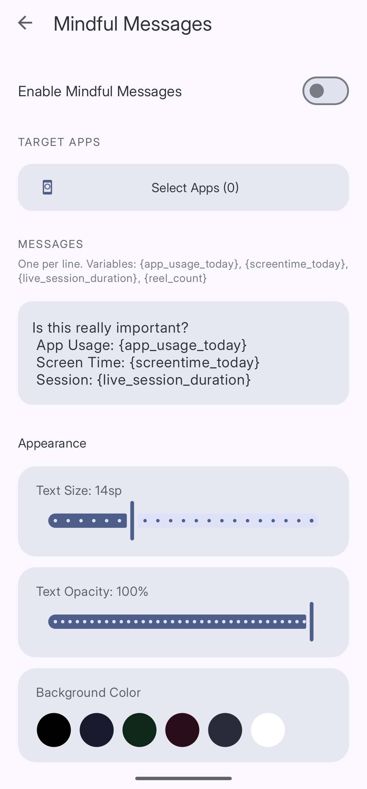

import { Steps, Aside } from '@astrojs/starlight/components';

**Mindful Messages** shows your text over a selected app. The message stays visible while you use the app.

Open **Gentle Prompts** in the **Reducers** list to configure Mindful Messages.


*A message can contain text and current usage values.*

## Configure Mindful Messages


*The message field accepts one message on each line.*

<Steps>
1. **Open Gentle Prompts**
   Tap **Reducers**. Then, tap **Gentle Prompts**.

2. **Turn on Mindful Messages**
   Turn on **Enable Mindful Messages**.

3. **Select apps**
   Tap **Select Apps**. Select the apps that must show a message.

4. **Enter messages**
   Enter the text in **MESSAGES**. Put each message on a separate line.

5. **Add placeholders (optional)**
   Add one or more placeholders from the reference table.
</Steps>

## Placeholder reference

Curbox replaces a placeholder with its current value when it shows the message.

| Placeholder | Value |
|---|---|
| `{app_usage_today}` | Use duration for the current app today |
| `{screentime_today}` | Total screen time today |
| `{live_session_duration}` | Continuous duration in the current app |
| `{reel_count}` | Number of short-form videos today |

Example:

```text
Complete the planned task.
App use today: {app_usage_today}
Screen time today: {screentime_today}
Current session: {live_session_duration}
```

## Change the appearance

Scroll to **Appearance**. Configure these controls:

- **Text Size** changes the text size.
- **Text Opacity** changes the text visibility.
- **Background Color** changes the overlay background.

<Aside type="tip">
Use high contrast between the text and the background. Check the message in each selected app.
</Aside>
