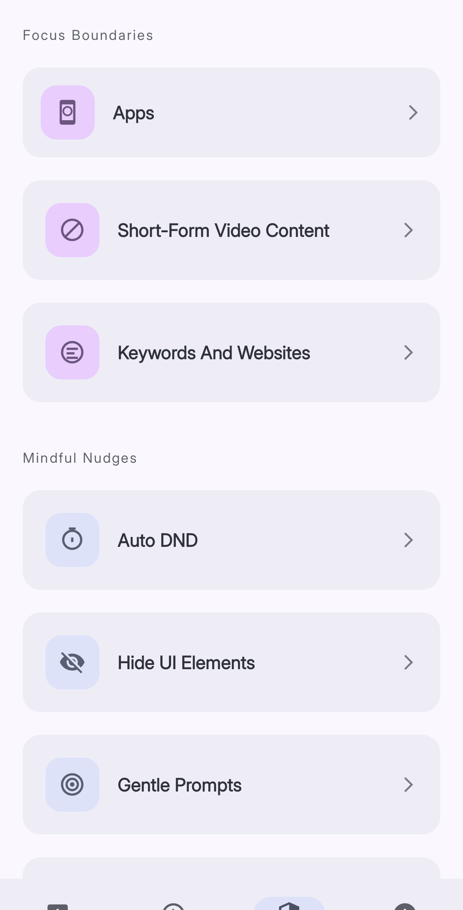
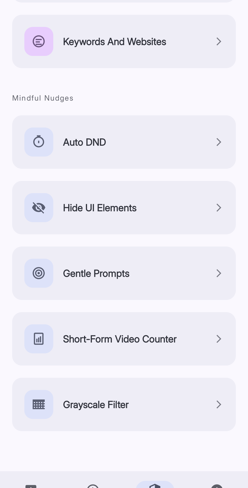

Reducers block distracting content or reduce its effect. Open **Reducers** from the bottom navigation bar.

You can use multiple reducers at the same time.

*The Focus Boundaries section contains blocking and limit features.*

## Focus Boundaries

Focus Boundaries block an app or content when configured conditions are true.

| Reducer | Function |
|---|---|
| **Apps** | Blocks selected apps on a schedule or after a usage limit |
| **Short-Form Video Content** | Blocks short-form videos on a schedule, after a time limit, or after a video limit |
| **Keywords And Websites** | Blocks matching website addresses in supported browsers |

## Mindful Nudges

Mindful Nudges change the device interface without a complete block.

| Reducer | Function |
|---|---|
| **Auto DND** | Turns on Do Not Disturb during configured schedules |
| **UI Hider** | Covers selected interface elements in supported apps |
| **Gentle Prompts** | Shows a configured message over selected apps |
| **Short-Form Video Counter** | Shows the number of short-form videos for the current day |
| **Grayscale Filter** | Removes color while a selected app is open |

## Select a first reducer

Use **Apps** if you need a time limit or a scheduled block. Use a Mindful Nudge if you want information without a complete block.

Configure one reducer first. Check its effect before you configure another reducer.
