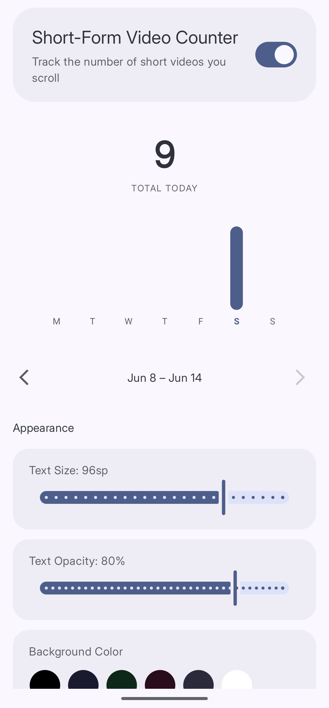

import { Steps } from '@astrojs/starlight/components';

**Short-Form Video Counter** shows the current video count over a supported app. It also records a daily and weekly count.

## Supported apps

Curbox includes support for these official apps:

- Instagram for Reels
- YouTube for Shorts
- Facebook for Reels
- TikTok

Community-maintained rules also support these modified apps:

- MyInsta
- YouTube ReVanced
- Morphe

## Turn on the counter

<Steps>
1. **Open Short-Form Video Counter**
   Tap **Reducers**. Then, tap **Short-Form Video Counter**.

2. **Turn on the counter**
   Turn on the switch at the top of the screen.
</Steps>

The counter appears when you view short-form videos in a supported app.

## Read the statistics

*The screen shows the current daily total and the weekly history.*

The screen contains these values:

- **TOTAL TODAY** is the number of short-form videos for the current day.
- The weekly chart shows one bar for each day.

Use the arrows below the chart to show a different week.

## Change the appearance

Scroll to **Appearance**. Configure these controls:

- **Text Size** changes the counter size.
- **Text Opacity** changes the counter visibility.
- **Background Color** changes the background behind the counter.
