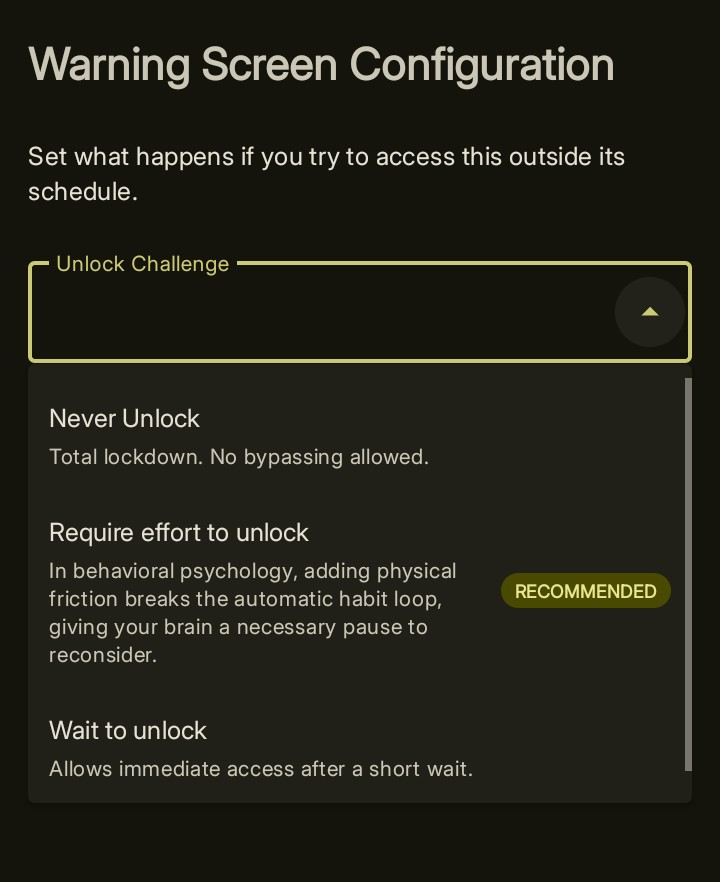

import { Aside, Tabs, TabItem } from '@astrojs/starlight/components';

Curbox shows a warning screen when a reducer blocks an app, website, or short-form video. An **Unlock Challenge** controls whether you can continue past the warning screen.

Open the applicable reducer group. Then, tap **Configure Warning Screen**.

## When the warning screen appears

The warning screen appears when the conditions for a block are true. For example, it appears when you reach a usage limit during an active schedule.

If you select **On each open**, the warning screen appears each time you open a configured app.

## Select an Unlock Challenge

Open **Unlock Challenge** on the **Warning Screen Configuration** screen. Select one of the available challenge types.

<Tabs>
  <TabItem label="Never Unlock">
    **Never Unlock** does not show a continue action. The block stays active while the reducer conditions are true.
  </TabItem>
  <TabItem label="Require Effort">
    **Require effort to unlock** makes an action necessary before you can continue.

    Curbox can show these actions:

    - **QR or Barcode Scan** requires the configured code. You can use a code on a product package.
    - **NFC** requires the configured NFC tag.
    - **Adaptive Math** requires answers to math questions.
    - **Type a Sentence** requires the displayed sentence.
    - **State Your Intent** requires a reason for opening the app. Curbox saves the reason for later review.

    Put a physical code or NFC tag away from the location where you usually use the app. This adds movement to the unlock process.
  </TabItem>
  <TabItem label="Wait to Unlock">
    **Wait to unlock** starts a timer before you can continue. It does not require another action.

    Select one of these timer types:

    - **Fixed time** uses the same duration for each warning.
    - **Dynamic time** changes the duration for each warning.
  </TabItem>
</Tabs>

## Add a delay timer

You can add a delay before Curbox shows the selected challenge. During the delay, Curbox increases the screen brightness and vibrates the device.

The delay and the Unlock Challenge are separate settings. If you configure both, the delay occurs first.

## Limit unlock frequency

Set an unlock limit to control how many times you can continue during a specified period. When you reach the limit, Curbox removes the continue action until the period resets.

## Add a daily focus requirement

Connect a Focus Group to the warning-screen configuration. Curbox permits an unlock only after you complete the specified daily focus duration.

## Add a custom message

Enter a short message that Curbox shows on the warning screen. Use a message that states the reason for the block.

Examples:

- `I will use this app for one planned task.`
- `I can continue after I complete my focus goal.`

<Aside type="tip">
Start with one challenge and a short delay. Add more controls only if the first configuration does not meet your goal.
</Aside>
